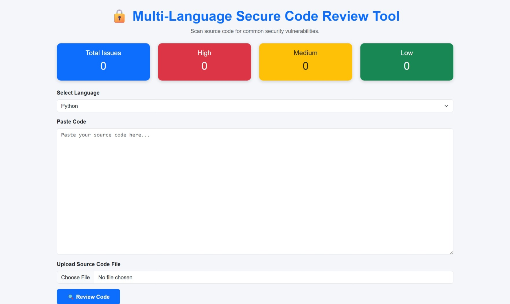
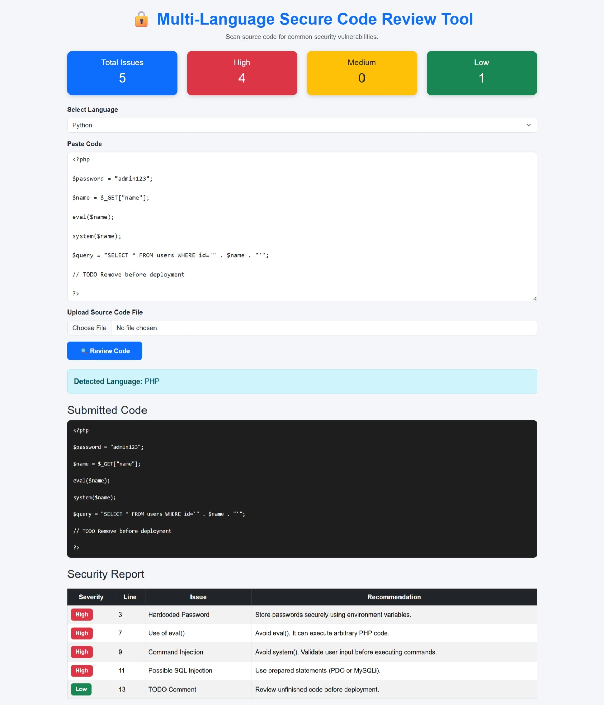

# 🔒 Multi-Language Secure Code Review Tool

A Flask-based web application that analyzes source code for common security vulnerabilities across multiple programming languages. Users can either paste code directly or upload source code files to receive a detailed security report with severity levels, line numbers, and recommendations.

---

## 📌 Features

- 🔍 Analyze source code for security vulnerabilities
- 🌐 Supports multiple programming languages
- 📄 Paste code or upload source code files
- 🚨 Detects High, Medium, and Low severity issues
- 📍 Displays line numbers for detected vulnerabilities
- 📊 Dashboard showing issue statistics
- 📑 Generate PDF security reports
- 📝 Generate text reports
- 💻 Simple and responsive Flask web interface

---

## 🛠 Supported Languages

- Python
- Java
- JavaScript
- TypeScript
- PHP
- C
- C++
- C#
- Go
- Ruby
- Kotlin
- Swift
- SQL
- HTML
- CSS
- Shell Script

---

## 🛡 Security Checks

The application detects common security issues such as:

- Use of `eval()`
- Use of `exec()`
- Hardcoded passwords
- SQL Injection
- Command Injection
- Shell Execution
- Weak Cryptography (MD5)
- Dangerous Imports
- Bare Exception Handling
- Insecure File Permissions
- TODO Comments
- Inline JavaScript
- Unsafe `innerHTML`
- Dangerous Shell Commands
- And many more...

---

## 🏗 Project Structure

```text
SecureCodeReview/
│── app.py
│── requirements.txt
│── README.md
│── .gitignore
│__ .images
├── scanner/
│   ├── analyzer.py
│   ├── python_rules.py
│   ├── java_rules.py
│   ├── javascript_rules.py
│   ├── php_rules.py
│   ├── c_rules.py
│   ├── cpp_rules.py
│   ├── csharp_rules.py
│   ├── go_rules.py
│   ├── ruby_rules.py
│   ├── kotlin_rules.py
│   ├── swift_rules.py
│   ├── sql_rules.py
│   ├── html_rules.py
│   ├── css_rules.py
│   ├── shell_rules.py
│   └── report.py
│
├── static/
│── templates/
└── uploads/
```

---

## ⚙ Installation

### 1. Clone the repository

```bash
git clone https://github.com/YOUR_USERNAME/Code-Alpha-Projects.git
```

### 2. Open the project

```bash
cd SecureCodeReview
```

### 3. Create a virtual environment

```bash
python -m venv venv
```

### 4. Activate the virtual environment

Windows

```bash
venv\Scripts\activate
```

Linux/macOS

```bash
source venv/bin/activate
```

### 5. Install dependencies

```bash
pip install -r requirements.txt
```

### 6. Run the application

```bash
python app.py
```

### 7. Open in browser

```
http://127.0.0.1:5000
```

---

## 📖 How to Use

1. Open the application.
2. Select the programming language.
3. Paste source code or upload a source code file.
4. Click **Review Code**.
5. View the detected language.
6. Review detected security vulnerabilities.
7. Download the generated security report.

---

## 📷 Screenshots

### Home Page




### Security Report



## 📊 Sample Output

| Severity | Issue | Recommendation |
|----------|-------|----------------|
| High | Hardcoded Password | Store passwords securely |
| High | SQL Injection | Use parameterized queries |
| Medium | Weak Cryptography | Use SHA-256 |
| Low | TODO Comment | Review before deployment |

---

## 🧰 Technologies Used

- Python
- Flask
- HTML
- CSS
- Bootstrap
- ReportLab
- Git
- GitHub

---

## 🚀 Future Enhancements

- AI-based vulnerability suggestions
- User authentication
- Scan history
- ZIP file scanning
- Syntax highlighting
- Dark mode
- Export reports in multiple formats
- Cloud deployment

---

## 👩‍💻 Author

**Neerukonda Varshini**

GitHub:
https://github.com/neerukondavarshini64

---

## 📄 License

This project is developed for learning and internship purposes.